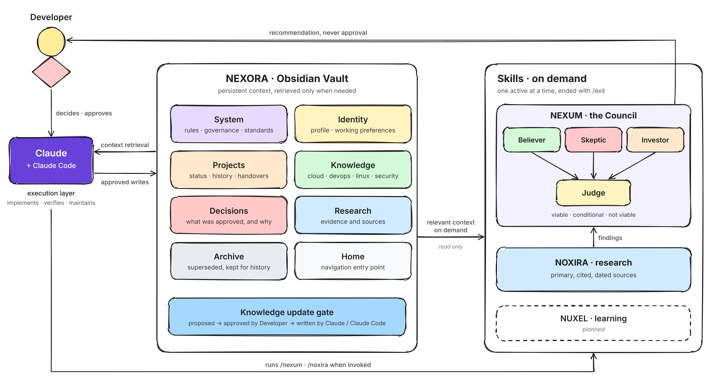

# NEXORA: a persistent brain for working with AI

NEXORA is the system I built so that AI stops starting from zero every
time I open a new chat. It is an Obsidian Vault that holds my context,
rules and project history, designed to work with two Claude Skills that
evaluate ideas and research them before anything gets built.

This repository explains what the system is, why it exists and how it is
organised. It does not contain the Vault itself.

Why would adding more rules make working with AI faster instead of slower?

Spoiler: because most of the time was never spent working. It was spent
re-explaining.

---

## The Problem

AI was already useful to me, but I was not getting anywhere near its full
potential.

A task that should have taken an hour with AI help regularly took much
longer. The extra time went into three things: explaining, correcting and
re-planning. The AI lacked context, mixed up details from different
projects and made mistakes I then had to catch.

The worst part was continuity. Every new chat about an existing project
meant one of two things:

- **Explain everything again** from the beginning.
- **Let the AI work from an old memory**, and then correct it over and
  over until it caught up with where the project really was.

Ideas had their own problem. When I explored something to build or sell,
I would often find out late that it was not feasible, that nobody did it
that way anymore, or that it already existed. Research did not help as
much as it should have: the AI sometimes leaned on sources I would not
trust, or struggled to find what I was actually looking for.

The default approach is to accept this as the cost of using AI: write
longer prompts, paste the same background into every chat, and double
check everything by hand. That treats the symptom. The real problem was
that the AI had no stable place to read who I am, how I work and where
each project stands.

---

## Finding the Solution

I started looking into how other people handled the same problem. One
name kept coming up: **Obsidian**, a Markdown note app where every note
is a plain file you own and notes link to each other.

After watching walkthroughs and reading about how people structured their
vaults, I decided to try it with a specific goal. Not a note collection
for me, but a **brain for the AI**: a place that tells it how I work,
what I am doing, what I prefer and what state each project is in.

The Vault addresses the memory problem. It does not address the decision
problem, so I designed two Claude Skills to sit on top of it:

- **NEXUM**, a Council. An idea goes through several filters, each one
  looking at it from a different analytical perspective, and a Judge
  closes with a verdict that includes the pros, the cons and the
  conditions that would change it.
- **NOXIRA**, a research workflow for digging deep into a topic with
  sources I can check.

---

## Architecture

Four components, one execution layer, one human authority. **NEXORA**
holds the context. **NEXUM** and **NOXIRA** evaluate and research a
problem when I invoke them, reading the context they need from the Vault
but never writing to it. **NUXEL**, the learning system, is planned.
**Claude and Claude Code** are the execution layer: they retrieve context,
do the work and write to the Vault only what I approve. I make the
decisions.

---

## Inside the Vault

### One entry point, one home for every fact

The Vault has a single navigation page that links to everything else.
Every stable fact or rule has one canonical home. Other notes link to it
instead of duplicating the authoritative record. That helps prevent the
AI from encountering conflicting versions of the same information.

| Area | What it holds |
| --- | --- |
| System | The rules of the whole setup: a short governing charter, collaboration and permission rules, metadata and naming standards, and operational guides such as how I publish repositories |
| Identity | My professional and technical context, so recommendations fit my real situation instead of a generic one |
| Projects | One area per project, with its status, history and a handover report a fresh session can pick up from |
| Knowledge | Technical notes grouped by domain: cloud, DevOps, Linux, programming and security |
| Decisions | What was approved, and the reasoning behind it |
| Research | Evidence and source material |
| Archive | Superseded documents, kept for history instead of deleted |

### A dated snapshot instead of a diary

One note is a short snapshot of where things stand today: active
priorities, project status and open questions. Each statement carries a
label: verified with dated evidence, recorded, planned or unknown. It is
designed so that a new session can read it first and know what is
established and what it must not assume.

### Rules for the AI, not just for me

The Vault tells Claude how to behave as much as it tells it what to know:

- Claude and Claude Code may read only within explicitly authorised
  scopes. **AI-initiated mutations require explicit, task-scoped
  approval.** Every change to the Vault requires explicit approval, and
  approval for one action is not approval for the next.
- Separate facts, reported information, assumptions and recommendations.
- If two notes disagree, show the conflict and ask. Never pick one
  silently.
- Useful new information is **proposed** to a review queue, not written
  directly.
- Never reproduce a secret value, even if one shows up in a file.

### NEXUM: the Council

Asking an AI "is this a good idea?" usually gets a polite yes. NEXUM is
designed to avoid that by evaluating a decision through four lenses.
They are not independent agents: they are four complementary analytical
lenses applied by one assistant, each examining the decision from a
different perspective.

| Perspective | Job |
| --- | --- |
| Believer | Builds the strongest honest case in favour |
| Skeptic | Looks for weak assumptions, risks, failure modes and simpler alternatives |
| Investor | Weighs time, cost, maintenance and opportunity cost |
| Judge | Synthesises the arguments and gives a recommendation: viable, conditional or not viable, with one next step |

By default only the Judge speaks, in a short verdict. I can request the
full Council analysis when a decision deserves it. NEXUM recommends. It
never approves.

### NOXIRA: research I can check

NOXIRA is designed to prefer official documentation and primary sources, cites every
material claim, dates time sensitive findings and separates facts from
vendor claims and estimates. When findings need a go or no-go decision,
it hands them to NEXUM instead of deciding itself.

---

## The Result

The difference is in how the work feels. I went from constantly
correcting the AI to having a more consistent working partner.

AI used to be a useful reference tool, like a faster Wikipedia. Now,
through the Council design, it can look at a project the way an engineer, an
investor and a sceptic would, before I commit time to it. Projects start
with a clear shape: what is being built, why, and under which conditions
it is worth it.

In practice:

- **Less re-explaining.** A new chat can start from the documented
  state of the project instead of an old memory.
- **Fewer correction loops.** The AI can work from the same documented
  source of truth I do, so it mixes up fewer things.
- **Ideas can be filtered early.** Weak or already solved ideas are caught
  by research and the Council, not after weeks of work.
- **Research I can trust.** Findings come with sources, dates and stated
  uncertainty.
- **Control stays with me.** AI-initiated mutations require explicit,
  task-scoped approval. Changes to the Vault always go through the
  approval gate.

This repository is itself an example. It was written by Claude following
a publishing guide that lives in the Vault, from answers I gave once.

---

## Design Decisions

**Why Obsidian.** Notes are plain Markdown files on my own disk. No lock
in, readable by any tool, easy to version with Git, and the links between
notes make relationships explicit.

**Why the AI cannot write freely.** A knowledge base that the AI edits on
its own slowly fills with guesses. Requiring approval keeps the Vault
something I can trust, at the cost of a little friction.

**Why separate roles.** Mixing research, evaluation and execution in one
conversation is how weak ideas get built quickly. Keeping them apart
means evidence is gathered before a verdict, and a verdict is given
before any work.

**Why describe the system instead of publishing it.** The Vault contains
personal and professional context that does not belong in a public
repository. The architecture is the part worth sharing.

---

## Status and Limitations

- **Implemented:** the Vault, its architecture, the governing charter,
  documentation and standards.
- **Designed:** the NEXUM and NOXIRA Skills. Their definitions exist;
  implementation and validation as Skills are still to be completed.
- **In progress:** the integration of the Obsidian Vault with Claude and
  Claude Code.
- **Early stage:** several Knowledge, Decisions and Research areas are
  still being filled in.
- **Planned:** NUXEL, a learning system that connects study goals to
  practical projects, and a 3D graph view of the Vault.
- **Not measured:** the improvements above are my own experience, not
  benchmarks.

---

## Author

Adrian Tamargo

[GitHub](https://github.com/AdrianStudio) · [LinkedIn](https://www.linkedin.com/in/adrian-tamargo)
